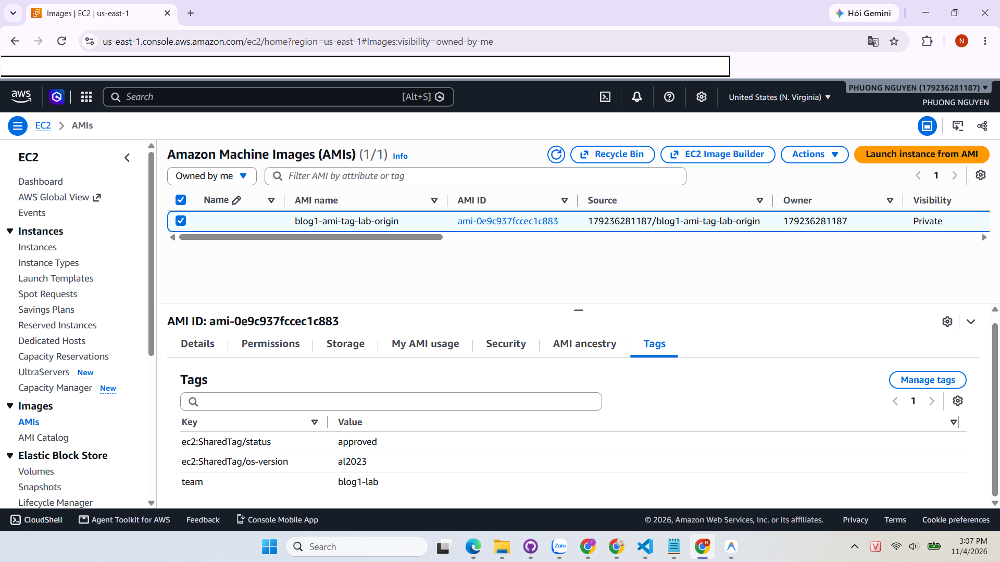
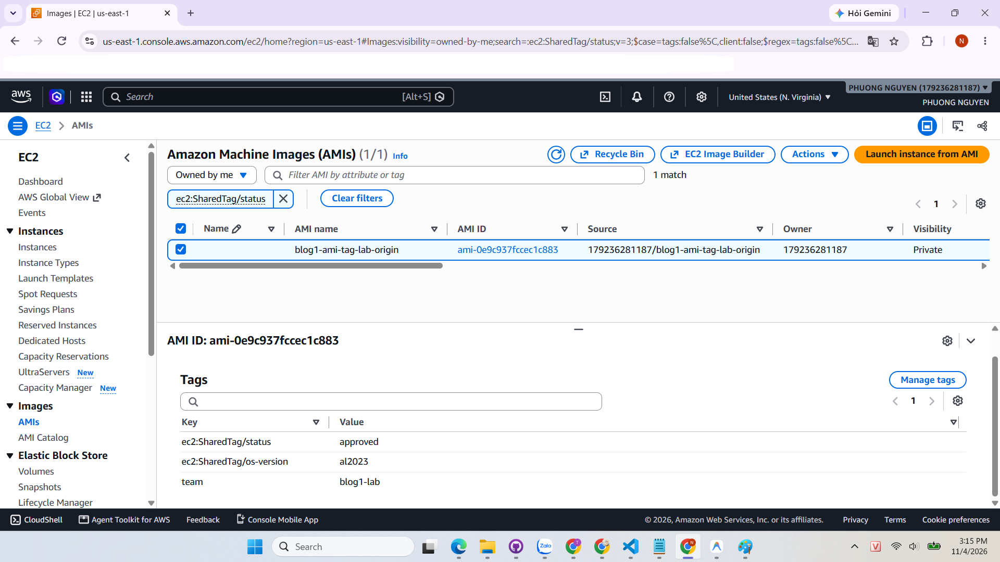
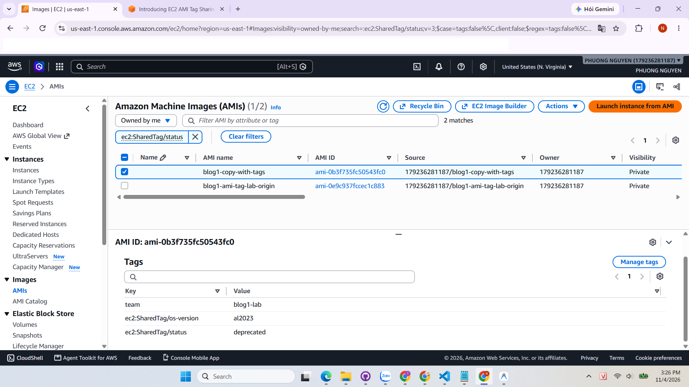
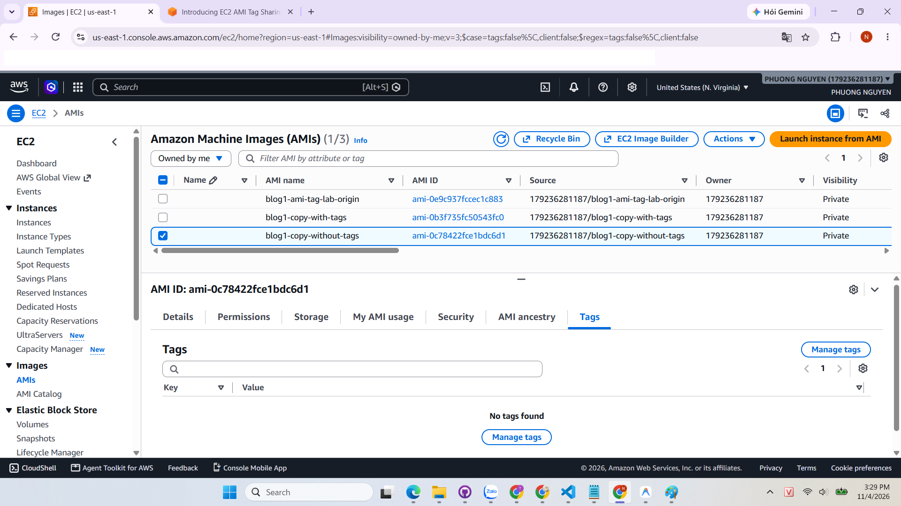

# EC2 AMI TAG SHARING: SHARING EC2 AMI TAGS ACROSS AWS ACCOUNTS

> Summary, analysis, and hands-on lab based on the original article **"Introducing EC2 AMI Tag Sharing: Share EC2 tags across AWS accounts"** (AWS Compute Blog, Oct 05, 2026, by Gena Gizzi and Smriti Ohri).  
> Source: <https://aws.amazon.com/blogs/compute/introducing-ec2-ami-tag-sharing-share-ec2-tags-across-aws-accounts/>

---

## 1. Background: Tags and AMIs

**Tags** are key-value pairs attached to AWS resources. They are widely used for cost tracking (FinOps), compliance auditing (Security), and attribute-based access control (ABAC).

**AMIs (Amazon Machine Images)** serve as templates used to launch EC2 instances. Many organizations tag their AMIs to record approval status, operating system version, owning team, and compliance levels.

---

## 2. Previous Challenges

Previously, when sharing an AMI with other AWS accounts, **tags did not carry over with the image**. Recipient accounts could see and launch the image, but could not see any metadata describing it. To bridge this gap, organizations had to build and maintain custom tag replication mechanisms, typically combining Amazon EventBridge, Amazon SNS, and AWS Lambda across accounts. This approach presented three major drawbacks:

- Required provisioning, configuring, and maintaining additional infrastructure.
- The volume of `CreateTags` API calls spiked dramatically with numerous AMIs across multiple Regions and accounts, causing API throttling or Lambda execution failures.
- Risk of **tag drift** whenever an asynchronous Lambda execution silently failed without compensatory retry mechanisms.

---

## 3. What is EC2 AMI Tag Sharing?

EC2 AMI Tag Sharing allows AMI owners to **share tags directly with the AMI** across all accounts that have access permissions (shared privately with specific accounts, across an AWS Organization, or publicly).

**Usage is straightforward:** prefix the tag key with `ec2:SharedTag/`.

| Tag Key | Visibility |
|---|---|
| `ec2:SharedTag/status` | AMI owner and all accounts with access to the shared AMI |
| `team` (no prefix) | AMI owner only (private tag) |

**Key rules to remember:**

- Only the **AMI owner** can create, modify, or delete tags with the `ec2:SharedTag/` prefix.
- Recipient accounts have **read-only** access to shared tags, but can still attach their own private tags to the shared AMI.
- When the owner updates a shared tag, the update is **automatically reflected** across all recipient accounts without custom automation.
- Shared tags count toward the owner's quota of **50 tags per resource**, not toward the recipient's quota.
- When copying an AMI with shared tags, the **Copy tags** parameter (`--copy-image-tags` in CLI) must be specified to duplicate tags.
- Currently, this feature **only supports AMI resources**, and does not apply to EBS Snapshots.

---

## 4. Primary Use Case: Golden AMI Pipeline

In enterprise multi-account architectures, organizations often establish a central build-factory account to package hardened, pre-configured AMIs (Golden AMIs) and share them with dozens or hundreds of workload accounts. These workload accounts enforce IAM policies or SCPs allowing instances to launch only from AMIs with valid approval tags:

| Criteria | Previously | With EC2 AMI Tag Sharing |
|---|---|---|
| **Synchronization** | EventBridge triggers SNS, invoking Lambda in each target account to call `CreateTags` | Owner simply attaches tags prefixed with `ec2:SharedTag/` once |
| **Updating status** (e.g. marking deprecated) | Pipeline must re-trigger across all recipient accounts | New value is instantly reflected in all recipient accounts natively |
| **Reliability & Overhead** | Susceptible to API throttling, Lambda failures, and tag drift | Native AWS platform feature with zero maintenance overhead |

---

## 5. Key Considerations

1. **Do not store sensitive data in shared tags**: Any account with access to the AMI can inspect all shared tags.
2. **Recipient ABAC policies apply to shared tags**: If an IAM policy restricts `ec2:RunInstances` to AMIs where `status=approved`, the tag `ec2:SharedTag/status=approved` satisfies that policy condition.
3. **Control resides with the AMI owner**: Recipient accounts cannot alter shared tag values, so recipient accounts should only trust AMIs from verified internal builder accounts.
4. **Combine with Allowed AMIs**: Use the **Allowed AMIs** feature to restrict instance launch permissions strictly to trusted internal accounts.

---

## 6. Hands-on Implementation

- **Environment:**
  - **Region:** `us-east-1` (US East - N. Virginia).
  - **Base Instance:** `blog1-ami-tag-lab`, instance type `t3.micro` / `t2.micro` (Free Tier), running Amazon Linux 2023 (`al2023-ami-kernel-default-x86_64`).
  - **Tool:** AWS Management Console (EC2 interface).
- **Execution Steps:**
  1. Launched a baseline EC2 instance running Amazon Linux 2023.
  2. Created the source AMI `blog1-ami-tag-lab-origin`. Assigned shared tags (`ec2:SharedTag/status=approved`, `ec2:SharedTag/os-version=al2023`) and a private tag (`team=blog1-lab`).
  3. Filtered and verified tags on the AWS Console: Used the *Filter AMI by attribute or tag* search bar with `ec2:SharedTag/status`, correctly matching the created AMI.
  4. Updated Shared Tag value: Simulated deprecating the AMI by navigating to *Manage tags* and changing `ec2:SharedTag/status` from `approved` to `deprecated`.
  5. Tested AMI Copy behavior:
     - **Copy 1 (`blog1-copy-with-tags`):** Enabled **Copy tags** ➔ Result: All tags (shared and private) were duplicated to the new AMI.
     - **Copy 2 (`blog1-copy-without-tags`):** Disabled **Copy tags** ➔ Result: The new AMI was created with no tags attached.
  6. Cleaned up resources: Deregistered all 3 AMIs, deleted all associated EBS Snapshots, and terminated the base instance to avoid unwanted storage charges.
- **Observations:**
  - Console filtering seamlessly handles the `ec2:SharedTag/*` prefix, simplifying AMI governance across distributed teams.
  - The **Copy tags** flag is critical when copying AMIs across Regions; omitting it strips all metadata and risks breaking ABAC policies in destination Regions.
- **Encountered Issues & Solutions:**
  - *Issue:* When creating the image with the default *"Tag image and snapshots together"* option, AWS returned an error: `Failed to create image: Tag key with shared tag prefix 'ec2:SharedTag/' is not supported for resource type 'snapshot'`.
  - *Cause & Resolution:* EC2 AMI Tag Sharing currently only supports AMI resources, not EBS Snapshots. This was resolved by choosing **"Tag image and snapshots separately"**, applying `ec2:SharedTag/` keys exclusively to the Image tags section and leaving the Snapshot tags section empty or with standard tags.

*Figure 1: Tags tab of source AMI displaying Shared Tags and private tag*

*Figure 2: Filtering AMIs by ec2:SharedTag/status on AWS Console*

*Figure 3: Copied AMI with Copy tags enabled preserving all tags*

*Figure 4: Copied AMI with Copy tags disabled possessing no tags*

---

## 7. Personal Insights

- **Operational Excellence & FinOps:**  
  Previously, keeping tags in sync across accounts in a Golden AMI pipeline required maintaining an event-driven mesh of EventBridge rules, SNS topics, and cross-account Lambda functions. This incurred operational cost, introduced throttling risks at scale, and caused tag drift when executions failed silently. Native support for `ec2:SharedTag/` eliminates this entire middleware layer with instantaneous synchronization and zero maintenance.
- **Security & Attribute-Based Access Control (ABAC):**  
  Enforcing read-only access for recipient accounts safeguards metadata integrity. However, it establishes a tight trust boundary with the owner account: if the owner account is compromised or unintentionally marks an unvetted image as `approved`, recipient accounts with tag-dependent IAM policies could inadvertently launch insecure workloads. Organizations should layer this with **Allowed AMIs** and AWS Organizations SCPs for defense in depth.
- **Enterprise Recommendations:**  
  For production Golden AMI workflows, standardizing on the following shared tags is highly recommended:
  - `ec2:SharedTag/status`: Values `approved` | `testing` | `deprecated` to govern instance launch permissions via IAM.
  - `ec2:SharedTag/os-version`: Identifies the standardized OS distribution (e.g., `al2023`, `ubuntu-22.04`).
  - `ec2:SharedTag/patch-date`: Captures the latest patch baseline date for automated SecOps compliance scans.
  - `ec2:SharedTag/compliance-tier`: Designates security benchmarks (e.g., `pci-dss`, `cis-benchmark-l1`).

---

## 8. References

- [Introducing EC2 AMI Tag Sharing: Share EC2 tags across AWS accounts (AWS Compute Blog)](https://aws.amazon.com/blogs/compute/introducing-ec2-ami-tag-sharing-share-ec2-tags-across-aws-accounts/)
- [Tag your Amazon EC2 resources (EC2 User Guide)](https://docs.aws.amazon.com/AWSEC2/latest/UserGuide/Using_Tags.html)
- [Allowed AMIs (EC2 User Guide)](https://docs.aws.amazon.com/AWSEC2/latest/UserGuide/ec2-allowed-amis.html)
- AWS Study Group post: *(Updating with post URL)*
