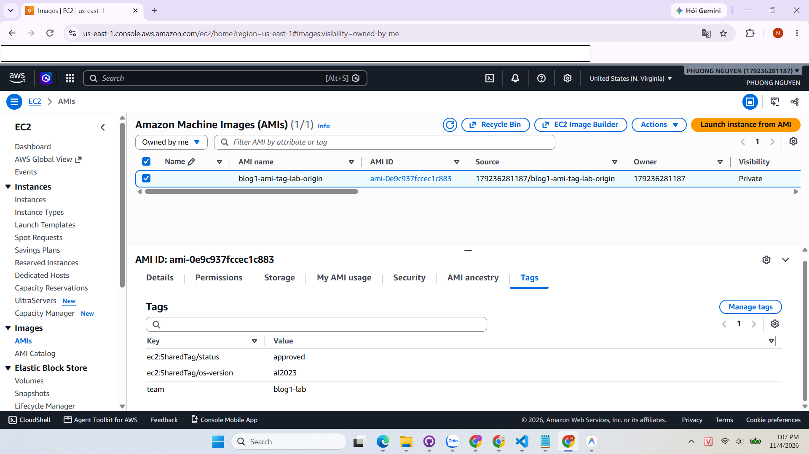
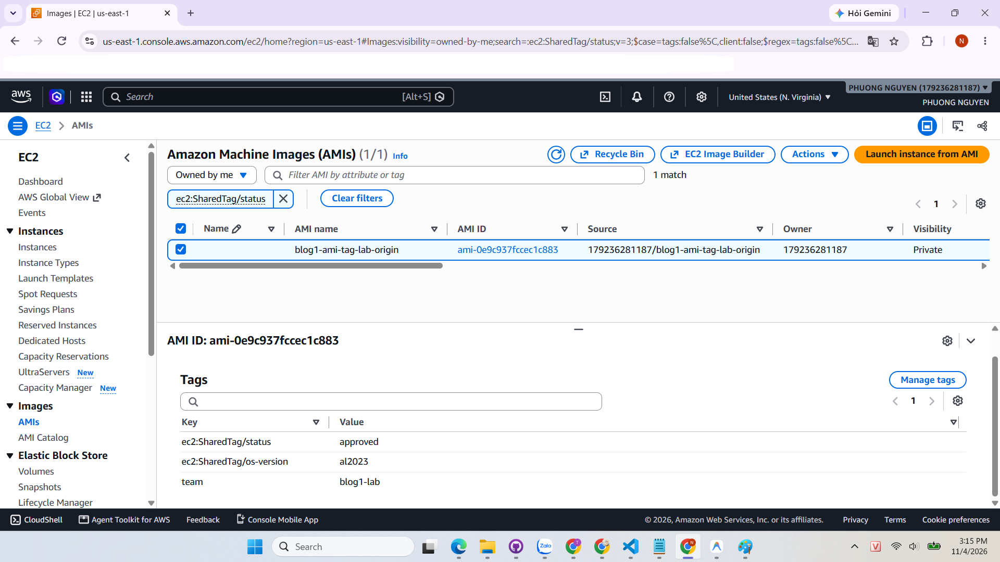
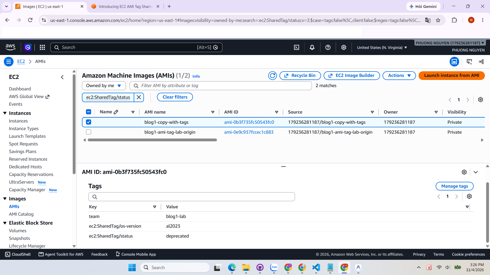
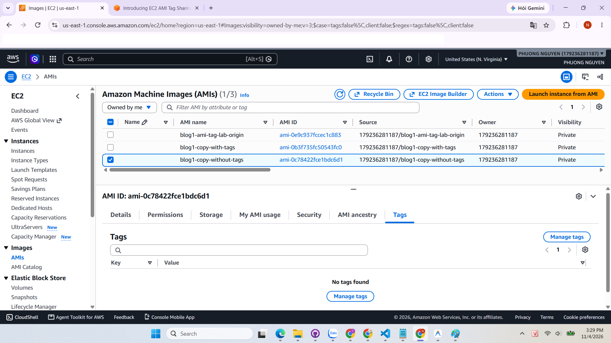

# EC2 AMI TAG SHARING: CHIA SẺ TAG CỦA AMI GIỮA CÁC TÀI KHOẢN AWS

> Bài viết tóm tắt, phân tích và thực hành dựa trên bài gốc **"Introducing EC2 AMI Tag Sharing: Share EC2 tags across AWS accounts"** (AWS Compute Blog, 05/10/2026, tác giả Gena Gizzi và Smriti Ohri).  
> Nguồn: <https://aws.amazon.com/blogs/compute/introducing-ec2-ami-tag-sharing-share-ec2-tags-across-aws-accounts/>

---

## 1. Bối cảnh: tag và AMI

**Tag** là các cặp key–value gắn vào tài nguyên AWS. Chúng được dùng để theo dõi chi phí (FinOps), kiểm soát tuân thủ (security) và phân quyền theo thuộc tính (ABAC – Attribute-Based Access Control).

**AMI (Amazon Machine Image)** là "bản mẫu" dùng để khởi tạo EC2 instance. Nhiều tổ chức gắn tag cho AMI để ghi trạng thái phê duyệt, phiên bản hệ điều hành, nhóm sở hữu...

---

## 2. Vấn đề trước đây

Khi chia sẻ một AMI sang tài khoản AWS khác, **tag không đi theo AMI**. Tài khoản nhận thấy image nhưng không thấy các thông tin mô tả nó. Muốn giải quyết, tổ chức phải tự dựng quy trình sao chép tag, thường dùng Amazon SNS và AWS Lambda. Cách này có ba nhược điểm lớn:

- Phải xây dựng, cấu hình và bảo trì thêm tài nguyên hạ tầng trung gian.
- Số lệnh `CreateTags` tăng vọt khi có nhiều AMI, nhiều Region và hàng trăm tài khoản, dễ dẫn đến bị throttling API hoặc lỗi thực thi Lambda.
- Dễ xảy ra hiện tượng lệch tag (*tag drift*) khi một lệnh gọi thất bại trong âm thầm mà không có cơ chế bù trừ.

---

## 3. EC2 Tag Sharing là gì?

Đây là tính năng cho phép chủ sở hữu AMI **chia sẻ tag cùng với AMI** cho mọi tài khoản có quyền truy cập image (chia sẻ riêng cho tài khoản cụ thể, cho cả tổ chức AWS Organizations, hoặc công khai).

**Cách dùng rất đơn giản:** đặt tiền tố `ec2:SharedTag/` vào đầu key của tag.

| Key của tag | Ai nhìn thấy |
|---|---|
| `ec2:SharedTag/status` | Chủ sở hữu và mọi tài khoản được chia sẻ AMI |
| `team` (không có tiền tố) | Chỉ chủ sở hữu (tag riêng tư) |

**Các quy tắc quan trọng cần nhớ:**

- Chỉ **chủ sở hữu AMI** mới được tạo, sửa, xóa tag có tiền tố `ec2:SharedTag/`.
- Tài khoản nhận chỉ có quyền **xem** (read-only) đối với shared tag, nhưng vẫn có thể tự thêm các tag riêng của tài khoản mình lên AMI đó.
- Khi chủ sở hữu cập nhật shared tag, thay đổi **tự động xuất hiện** ở các tài khoản nhận gần như tức thì mà không cần bất kỳ quy trình sao chép thủ công nào.
- Shared tag được tính vào hạn mức **50 tag/tài nguyên** của chủ sở hữu, không tiêu tốn hạn mức tag của tài khoản nhận.
- Khi copy AMI có shared tag, cần bật tùy chọn sao chép tag (**Copy tags** trên Console hoặc cờ `--copy-image-tags` trên CLI) để tag được nhân bản theo.
- Ở thời điểm hiện tại, tính năng **chỉ hỗ trợ tài nguyên AMI**, chưa áp dụng cho EBS Snapshot.

---

## 4. Use case tiêu biểu: Golden AMI Pipeline

Nhiều tổ chức doanh nghiệp xây dựng mô hình tài khoản tập trung ("build factory" / "central shared-services account") chuyên đóng gói các AMI đã được gia cố bảo mật và cài sẵn phần mềm tiêu chuẩn (Golden AMI), sau đó chia sẻ cho hàng trăm tài khoản workload. Các tài khoản này áp dụng IAM Policy hoặc Service Control Policies (SCPs) để chỉ cho phép khởi chạy instance từ các AMI có tag hợp lệ:

| Tiêu chí | Trước đây | Với EC2 AMI Tag Sharing |
|---|---|---|
| **Cơ chế đồng bộ** | EventBridge bắt sự kiện, SNS gửi thông báo, Lambda ở từng tài khoản đích gọi `CreateTags` | Chủ sở hữu chỉ cần gắn tag có tiền tố `ec2:SharedTag/` một lần duy nhất |
| **Khi cập nhật trạng thái** (ví dụ đánh dấu deprecated) | Phải kích hoạt lại toàn bộ pipeline đồng bộ qua Lambda | Trạng thái mới tự động phản ánh tức thì ở mọi tài khoản nhận |
| **Độ tin cậy & Rủi ro** | Dễ bị throttling API, lỗi Lambda, tag drift | Đồng bộ ở tầng nền tảng AWS (native), loại bỏ hoàn toàn mã nguồn trung gian |

---

## 5. Những điều cần lưu ý

1. **Không đưa thông tin nhạy cảm vào shared tag**: Mọi tài khoản có quyền đọc AMI đều đọc được toàn bộ shared tag.
2. **Chính sách ABAC ở tài khoản nhận vẫn áp dụng cho shared tag**: Ví dụ, nếu chính sách IAM chỉ cho phép `ec2:RunInstances` khi AMI có tag `status=approved`, thì tag `ec2:SharedTag/status=approved` sẽ kích hoạt điều kiện này.
3. **Quyền kiểm soát thuộc về tài khoản chủ sở hữu**: Tài khoản nhận không thể can thiệp vào giá trị shared tag, do đó chỉ nên tin tưởng các AMI đến từ tài khoản được phê duyệt trong nội bộ tổ chức.
4. **Kết hợp với Allowed AMIs**: Nên thiết lập tính năng **Allowed AMIs** để giới hạn chỉ những AMI từ tài khoản nội bộ đáng tin cậy mới được phép khởi chạy trong hệ thống.

---

## 6. Thực hành của mình

- **Môi trường thực hành:**
  - **Region:** `us-east-1` (US East - N. Virginia).
  - **Instance nền:** `blog1-ami-tag-lab`, cấu hình loại `t3.micro` (Free Tier), hệ điều hành Amazon Linux 2023 (`al2023-ami-kernel-default-x86_64`).
  - **Công cụ thực hiện:** AWS Management Console (giao diện EC2).
- **Các bước đã thực hiện:**
  1. Khởi chạy một EC2 instance nền Amazon Linux 2023 để làm mẫu tạo image.
  2. Tạo AMI gốc `blog1-ami-tag-lab-origin` từ instance nền. Cấu hình gán đồng thời shared tag (`ec2:SharedTag/status=approved`, `ec2:SharedTag/os-version=al2023`) và tag riêng (`team=blog1-lab`).
  3. Lọc và kiểm tra tag trên giao diện Console: Dùng thanh tìm kiếm *Filter AMI by attribute or tag* lọc theo `ec2:SharedTag/status`, kết quả trả về chính xác 1 AMI khớp điều kiện.
  4. Cập nhật Shared Tag: Mô phỏng quá trình loại bỏ AMI khỏi vòng đời chuẩn bằng cách vào *Manage tags*, đổi giá trị `ec2:SharedTag/status` từ `approved` sang `deprecated`.
  5. Thử nghiệm tính năng sao chép AMI (Copy AMI):
     - **Bản sao 1 (`blog1-copy-with-tags`):** Bật tùy chọn **Copy tags** ➔ Kết quả: Toàn bộ tag (cả shared tag lẫn tag riêng) được sao chép nguyên vẹn sang image mới.
     - **Bản sao 2 (`blog1-copy-without-tags`):** Bỏ tích chọn **Copy tags** ➔ Kết quả: Image mới được tạo ra hoàn toàn không mang theo tag nào từ bản gốc.
  6. Dọn dẹp tài nguyên (Cleanup): Hủy đăng ký (Deregister) cả 3 AMI, xóa sạch toàn bộ các EBS Snapshots tương ứng và Terminate instance nền để tránh phát sinh chi phí lưu trữ ngoài ý muốn.
- **Kết quả quan sát được:**
  - Giao diện AWS Console hỗ trợ tìm kiếm và lọc theo tiền tố `ec2:SharedTag/*` rất trực quan, giúp các kỹ sư quản trị dễ dàng phân loại và kiểm soát danh mục AMI.
  - Tùy chọn **Copy tags** đóng vai trò cực kỳ quan trọng khi thực hiện sao chép AMI giữa các Region: nếu không bật cờ này, bản sao AMI sẽ mất sạch metadata và có thể làm gãy các chính sách ABAC tại Region đích.
- **Khó khăn gặp phải và cách xử lý:**
  - *Lỗi gặp phải:* Ở lần đầu bấm tạo AMI với tùy chọn mặc định *"Tag image and snapshots together"*, hệ thống AWS trả về thông báo lỗi: `Failed to create image: Tag key with shared tag prefix 'ec2:SharedTag/' is not supported for resource type 'snapshot'`.
  - *Nguyên nhân & Cách khắc phục:* Tính năng EC2 Shared Tag hiện tại chỉ hỗ trợ duy nhất cho tài nguyên AMI, chưa hỗ trợ cho EBS Snapshot. Tôi đã xử lý bằng cách tích chọn sang chế độ **"Tag image and snapshots separately"**, giữ nguyên các tag có tiền tố `ec2:SharedTag/` ở phần Image tags và để trống/chỉ gán tag thường ở phần Snapshot tags. Quá trình tạo image sau đó thành công ngay lập tức.

*Hình 1: Tab Tags của AMI gốc hiển thị đầy đủ Shared Tag và Tag riêng*

*Hình 2: Lọc tìm kiếm AMI theo tiền tố ec2:SharedTag/status trên AWS Console*

*Hình 3: AMI sao chép khi có tích chọn Copy tags mang theo đầy đủ các tag*

*Hình 4: AMI sao chép khi bỏ chọn Copy tags hoàn toàn không có tag nào*

---

## 7. Nhận xét của mình

- **Tối ưu hóa kiến trúc và vận hành (Operational Excellence & FinOps):**  
  Trước đây, việc đồng bộ tag giữa các tài khoản AWS trong mô hình Golden AMI pipeline đòi hỏi phải duy trì cơ chế Event-driven phức tạp (Amazon EventBridge, Amazon SNS và AWS Lambda chạy cross-account). Mô hình cũ không chỉ tiêu tốn chi phí vận hành, tiềm ẩn nguy cơ Lambda bị throttling khi scale lớn, mà còn dễ gây ra hiện tượng *tag drift* (lệch trạng thái tag giữa các tài khoản nếu Lambda thực thi thất bại). Việc AWS hỗ trợ native tiền tố `ec2:SharedTag/` đã giải quyết triệt để bài toán này với độ trễ phản ánh gần như tức thì và loại bỏ hoàn toàn nhu cầu duy trì mã nguồn hạ tầng trung gian.
- **Góc nhìn bảo mật và phân quyền theo thuộc tính (ABAC):**  
  Việc các tài khoản nhận chỉ có quyền đọc (read-only) đối với shared tag là một điểm cộng lớn giúp bảo vệ tính toàn vẹn của trạng thái phê duyệt AMI. Tuy nhiên, điều này tạo ra một ranh giới tin cậy (trust boundary) chặt chẽ phụ thuộc vào tài khoản chủ sở hữu (central account). Nếu tài khoản chủ sở hữu bị chiếm quyền điều khiển hoặc thao tác nhầm đổi `deprecated` thành `approved`, các tài khoản con áp dụng IAM Policy dựa trên tag này sẽ vô tình khởi chạy các workload không an toàn. Do đó, tổ chức vẫn cần kết hợp chặt chẽ với cơ chế **Allowed AMIs** hoặc AWS Organizations SCPs để kiểm soát đa tầng.
- **Ứng dụng thực tế trong dự án doanh nghiệp:**  
  Trong môi trường sản xuất thực tế, tôi sẽ áp dụng bộ quy chuẩn tag chia sẻ sau cho toàn bộ Golden AMI:
  - `ec2:SharedTag/status`: Nhận các giá trị `approved` | `testing` | `deprecated` (dùng trong IAM Policy để chỉ cho phép khởi chạy instance khi status là `approved`).
  - `ec2:SharedTag/os-version`: Định danh phiên bản hệ điều hành chuẩn (ví dụ: `al2023`, `ubuntu-22.04`).
  - `ec2:SharedTag/patch-date`: Lưu ngày cập nhật bản vá bảo mật gần nhất để đội ngũ SecOps quét audit định kỳ và tự động cảnh báo các AMI quá hạn 30 ngày.
  - `ec2:SharedTag/compliance-tier`: Phân loại mức độ tuân thủ tiêu chuẩn an toàn (ví dụ: `pci-dss`, `cis-benchmark-l1`).

---

## 8. Tài liệu tham khảo

- [Introducing EC2 AMI Tag Sharing: Share EC2 tags across AWS accounts (AWS Compute Blog)](https://aws.amazon.com/blogs/compute/introducing-ec2-ami-tag-sharing-share-ec2-tags-across-aws-accounts/)
- [Tag your Amazon EC2 resources (EC2 User Guide)](https://docs.aws.amazon.com/AWSEC2/latest/UserGuide/Using_Tags.html)
- [Allowed AMIs (EC2 User Guide)](https://docs.aws.amazon.com/AWSEC2/latest/UserGuide/ec2-allowed-amis.html)
- Bài đăng trên nhóm AWS Study Group: 
