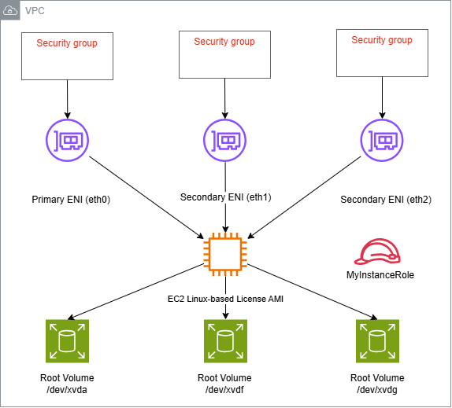
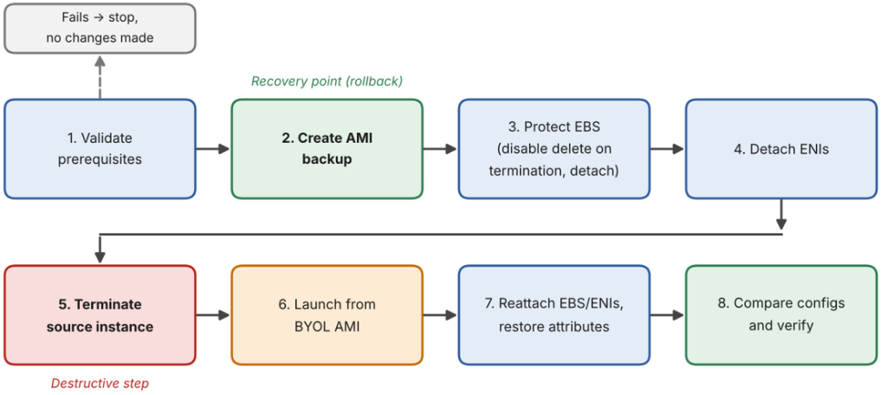

# AUTOMATING EC2 LICENSE MIGRATION FROM AWS MARKETPLACE TO BYOL

> **Analytical Note:** This article represents a **purely theoretical and architectural evaluation** based on AWS technical documentation and the design of the open-source utility `sample-ami-to-byol`. It is neither a hands-on implementation guide nor an empirical benchmark report.  
> **Source Reference:** <https://aws.amazon.com/blogs/migration-and-modernization/automating-ec2-license-migration-from-aws-marketplace-to-byol/>

---

## 1. Theoretical Overview

### 1.1. The Economics of Cloud Licensing Models
When an Amazon EC2 instance is provisioned from a **License Included (LI)** Amazon Machine Image (AMI) on AWS Marketplace, the software licensing premium is integrated directly into the hourly compute rate. This operational expenditure (OPEX) model is advantageous for rapid prototyping and short-term computing needs.

However, when an enterprise maintains pre-existing enterprise licensing agreements (e.g., Red Hat Enterprise Linux - RHEL or SUSE Linux Enterprise Server - SLES), deploying on an LI model results in **redundant software expenditures**: paying the third-party software vendor directly while concurrently paying the bundled licensing surcharge to AWS.

From an AWS systems architecture standpoint, licensing identifiers are immutably attached to an EC2 instance at the time of invocation (`RunInstances`). Consequently, an active instance cannot simply undergo an in-place license flag update. The architectural solution necessitates **replacing the underlying compute container with a new instance provisioned from a certified BYOL AMI**, while systematically preserving storage volumes, network interfaces, IP addresses, and identity profiles.

```
License Included (LI) Model:
  Total Hourly Cost = [EC2 Base Compute] + [Marketplace Software Premium]

Bring Your Own License (BYOL) Model:
  Total Hourly Cost = [EC2 Base Compute Only] (Software licenses settled externally)
```

### 1.2. Objectives and Scope of Analysis
* **Objectives:**
  1. Contrast the operational models of License Included (LI) and Bring Your Own License (BYOL).
  2. Dissect the decoupled anatomy of an Amazon EC2 instance to evaluate component persistence.
  3. Analyze the finite-state machine orchestration and AWS EC2 API interactions underpinning the `sample-ami-to-byol` utility.
  4. Formulate a theoretical risk model addressing data safety, maintenance windows, rollback viability, and Total Cost of Ownership (TCO).
* **Scope:** Focuses strictly on Linux-based enterprise Marketplace AMIs (RHEL, SLES, Fortinet); Windows platforms remain out of scope. Quoted financial reductions (15–40%) and execution durations (15–20 minutes) serve as theoretical benchmarks derived from AWS literature.

---

## 2. Architectural Foundations

### 2.1. Structural Anatomy of an AMI
An AMI represents a unified template encapsulating:
* The root operating system kernel and core system utilities.
* Default block device mapping specifications.
* Inflexible billing identifiers and product license codes.

Because the destination BYOL AMI governs the newly instantiated compute instance, strict architectural symmetry is required across:
* **Processor Architecture:** x86_64 vs. ARM64 (AWS Graviton).
* **Boot Mode Semantics:** Legacy BIOS vs. Unified Extensible Firmware Interface (UEFI).
* **Root Device Hierarchy:** Device path definitions (`/dev/xvda` vs. `/dev/sda1`).
* **Hypervisor Compatibility:** Nitro-based instance compatibility vs. legacy Xen architectures.

### 2.2. Structural Comparison: License Included vs. BYOL

| Dimension | License Included (LI) | Bring Your Own License (BYOL) |
| :--- | :--- | :--- |
| **Licensing Anchor** | Tied directly to the AWS billing meter | Tied to external contractual agreements with software vendors |
| **Billing Frequency** | Elastic, pay-as-you-go per second/hour | Fixed subscriptions, core-based, or socket-based contracts |
| **Entitlement Activation** | Automated platform-level provisioning | Explicit registration against vendor license authorities (e.g., Satellite, SCC) |
| **Usage Rights** | Bound by AWS Marketplace End-User Terms | Requires explicit Cloud Deployment Rights within enterprise contracts |
| **Compliance Liability** | Managed and guaranteed by the cloud provider | Full legal and audit liability rests entirely with the customer |

> **Core Theoretical Insight:** The "BYOL" label on an AWS AMI merely indicates an image devoid of AWS-metered software surcharges. It does not confer legal entitlement to run the software without an authentic, valid agreement with the software vendor.

---

## 3. The Decoupled Cloud Resource Model

Architecturally, an Amazon EC2 instance is not an indivisible entity. It is fundamentally a composite construct comprising four decoupled layers:

$$\text{EC2 Instance} = \text{Compute Engine} \oplus \text{EBS Storage} \oplus \text{ENI Network} \oplus \text{IAM Identity}$$


*Figure 1: Decoupled resource architecture of an Amazon EC2 Linux instance*

* **Compute Layer:** Transient execution capacity (vCPU and Memory).
* **Storage Layer (EBS):** Persistent block storage housing operating system structures and application data (`/dev/xvda`, `/dev/xvdf`, `/dev/xvdg`).
* **Network Layer (ENI):** Virtual network interfaces preserving Primary ENI (`eth0`), Secondary ENIs (`eth1`, `eth2`), private IPv4/IPv6 addresses, Elastic IPs, and Security Group bindings.
* **Identity Layer (IAM Profile):** Cryptographic credential provider (`MyInstanceRole`) enabling interactions with AWS API endpoints.

| Component | Migration Role | Critical Governance Checkpoints |
| :--- | :--- | :--- |
| **Source Instance** | Active instance running the paid Marketplace AMI | Confirm correct Instance ID, enforce `Stopped` status, verify non-Spot lifecycle. |
| **Backup AMI** | Definitive rollback baseline | Verify successful snapshot generation and `available` image state prior to destructive actions. |
| **EBS Volumes** | Storage layer for OS and application data | Document Volume IDs and device mapping paths (`/dev/xvda`, etc.); toggle `DeleteOnTermination` off. |
| **Network Interfaces (ENI)** | Network communication infrastructure | Retain Private IPs, Elastic IPs, Security Group assignments, and device index positioning. |
| **IAM Instance Profile** | Workload identity and authorization | Reattach the exact instance profile based on Least Privilege principles. |
| **Target BYOL AMI** | Foundation for the replacement instance | Confirm OS release, architecture, boot mode compatibility, and valid licensing entitlements. |

---

## 4. Pre-Migration Prerequisites (Theoretical Baseline)

1. **Source Instance State:** Must be transitioned to an absolute `Stopped` state to ensure data block consistency during snapshot generation and volume detachment.
2. **Exclusion of Spot Instances:** Spot instances are architecturally unsupported due to hypervisor-level reclamation policies that prevent consistent reattachment orchestration.
3. **Target AMI Compatibility:** Must align with the exact boot mode (BIOS vs. UEFI) and root device mapping convention of the source instance to prevent boot failures.
4. **Execution Permissions:** The orchestration engine requires broad, granular IAM permissions covering `Describe*`, `CreateImage`, `ModifyInstanceAttribute`, `DetachVolume`, `DetachNetworkInterface`, `TerminateInstances`, `RunInstances`, and `Attach*`.

---

## 5. State Machine Orchestration and Execution Lifecycle

### 5.1. Finite-State Machine Topology
The automation workflow executed by tools such as `sample-ami-to-byol` functions as a deterministic state machine incorporating an **irreversible, destructive milestone** at its center.


*Figure 2: End-to-end migration lifecycle and orchestration flow*

### 5.2. Process Phases and Associated AWS EC2 APIs

| Phase | Technical Execution | Associated EC2 APIs | Operational Objective |
| :--- | :--- | :--- | :--- |
| **1. Validation** | Inspect metadata, power state, lifecycle, and architecture | `DescribeInstances`, `DescribeVolumes`, `DescribeNetworkInterfaces` | Enforce preconditions; halt execution before modifications occur |
| **2. Backup** | Generate a full-state AMI of the source instance | `CreateImage` | Establish a reliable fallback and recovery baseline |
| **3. EBS Protection** | Catalog volume mapping, disable deletion flags, detach | `ModifyInstanceAttribute`, `DetachVolume` | Prevent storage deletion upon instance termination |
| **4. ENI Detach** | Unbind designated network interfaces | `DetachNetworkInterface` | Preserve network identifiers, routing, and access rules |
| **5. Source Deletion**| Terminate source instance once dependencies are detached | `TerminateInstances` | Decommission paid compute container; irreversible action |
| **6. Provisioning** | Launch replacement instance from target BYOL AMI | `RunInstances` | Instantiate target computing resource with new Instance ID |
| **7. Reattachment** | Re-bind volumes in precise order, attach ENIs, reapply role | `AttachVolume`, `AttachNetworkInterface`, `ModifyInstanceAttribute` | Reconnect persistent storage, networking, and authorization |
| **8. Audit** | Compare original metadata with the target deployment | Corresponding `Describe*` calls | Surface configuration discrepancies for engineering sign-off |

---

## 6. Theoretical Analysis of Ordering Constraints

System integrity during migration depends strictly on the **chronological sequence** of operational steps:

1. **EBS Lifecycle Interdependency:**
   * By default, EC2 root volumes often carry `DeleteOnTermination = True`.
   * *Theoretical Consequence:* If `TerminateInstances` executes prior to updating this parameter to `False` via `ModifyInstanceAttribute`, the root volume containing OS states and operational data is permanently deleted. Volume protection must strictly precede instance termination.
2. **Availability Zone (AZ) Confinement:**
   * EBS volumes and ENIs are strictly scoped to a specific Availability Zone and cannot bridge across AZ boundaries.
   * *Theoretical Consequence:* The replacement instance must be explicitly placed in the exact Subnet and AZ of the source machine; failure to maintain AZ affinity causes `AttachVolume` and `AttachNetworkInterface` operations to fail categorically.
3. **Instance ID Immutability:**
   * Cloud hypervisors guarantee that the newly launched instance receives a distinct, unique `Instance ID`.
   * *Theoretical Consequence:* Any peripheral monitoring or automation constructs bound specifically to the legacy Instance ID (e.g., CloudWatch Metric Alarms, Target Groups, AWS Backup plans) will experience broken linkages, requiring metadata reconfiguration.

---

## 7. Theoretical Validation Framework (7 Tiers of Verification)

A comprehensive architectural verification model assesses post-migration operational integrity across 7 discrete validation tiers:

```
[Tier 1: Platform Level]     ──> 2/2 status checks, instance type, AMI verification
[Tier 2: OS Kernel Level]    ──> Boot mode, kernel release, root filesystem mounts
[Tier 3: Storage Hierarchy]  ──> Block device mapping paths, UUID alignment, disk capacity
[Tier 4: Network & Security] ──> ENI device indexing, Private/Elastic IP preservation, SG rules
[Tier 5: Identity & IAM]     ──> Instance Profile validation, AWS API execution capability
[Tier 6: Application Layer]  ──> System daemon responsiveness, network sockets, DB integrity
[Tier 7: License Entitlement]──> Successful registration with external vendor licensing authority
```

---

## 8. Risk Modeling and Total Cost of Ownership (TCO)

### 8.1. Downtime Equation
Because the source instance must transition to the `Stopped` state to ensure snapshot integrity and enable volume detachment, this workflow is not a zero-downtime operation. Total downtime is modeled as:

$$T_{\text{downtime}} = T_{\text{snapshot}} + T_{\text{orchestration}} + T_{\text{boot}} + T_{\text{activation}} + T_{\text{audit}}$$

### 8.2. Cloud Economic Formulation
The net financial viability is governed by the Net Total Cost of Ownership ($\Delta_{\text{TCO}}$):

$$\Delta_{\text{TCO}} = \left( C_{\text{EC2\_LI}} - C_{\text{EC2\_BYOL}} \right) - \left( C_{\text{Vendor\_License}} + C_{\text{Storage\_Retention}} + C_{\text{Operational\_Downtime}} \right)$$

The architectural decision to migrate to BYOL yields positive financial returns only when the hourly differential between LI and BYOL compute rates exceeds the external software license amortized cost plus secondary storage retention fees.

---

## 9. Conclusion
Migrating an EC2 instance from an AWS Marketplace License Included AMI to a BYOL model is fundamentally an exercise in **cloud resource transposition and state re-association**, rather than a cosmetic reconfiguration. Successful operational execution is governed by:
1. A rigorous theoretical understanding of the decoupled nature of compute, storage, and networking in cloud environments.
2. Strict adherence to operational sequencing to protect persistent data layers prior to initiating compute termination.
3. A clear distinction between cloud infrastructure orchestration and contractual software license entitlement.

---

## 10. References
* **AWS Architecture Blog:** *Automating EC2 License Migration from AWS Marketplace to BYOL* – [Link](https://aws.amazon.com/blogs/migration-and-modernization/automating-ec2-license-migration-from-aws-marketplace-to-byol/)
* **AWS Samples Code Repository:** *sample-ami-to-byol* – [Link](https://github.com/aws-samples/sample-ami-to-byol)
* **AWS License Manager User Guide:** [Link](https://docs.aws.amazon.com/license-manager/latest/userguide/)
* **Amazon EC2 Linux Instances Architecture Guide:** [Link](https://docs.aws.amazon.com/AWSEC2/latest/UserGuide/)
