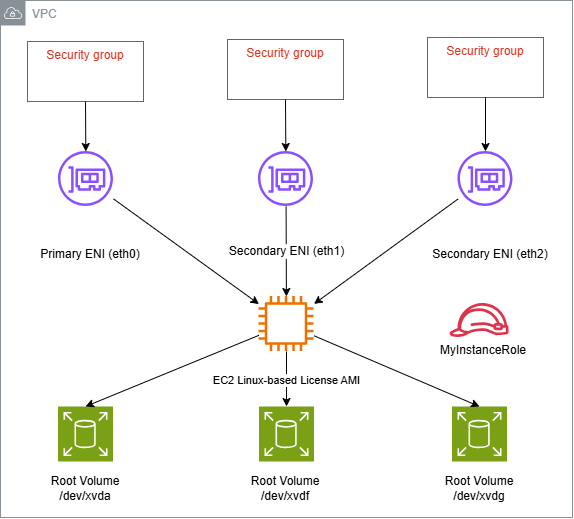
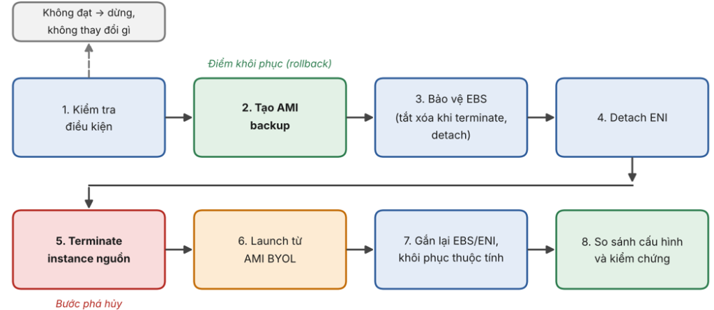

# CHUYỂN ĐỔI EC2 TỪ AMI MARKETPLACE SANG BYOL BẰNG CÔNG CỤ TỰ ĐỘNG HÓA

> **Ghi chú phân tích:** Bài viết này thuần túy là **phân tích lý thuyết và đánh giá kiến trúc** dựa trên tài liệu kỹ thuật của AWS và mã nguồn công cụ mẫu `sample-ami-to-byol`. Nội dung không đóng vai trò là một tài liệu hướng dẫn thực hành hay báo cáo thử nghiệm thực địa.  
> **Nguồn tham khảo:** <https://aws.amazon.com/blogs/migration-and-modernization/automating-ec2-license-migration-from-aws-marketplace-to-byol/>

---

## 1. Tổng quan lý thuyết

### 1.1. Bản chất bài toán chi phí từ mô hình cấp phép
Khi một EC2 instance được khởi tạo từ một Amazon Machine Image (AMI) dạng **License Included (LI)** trên AWS Marketplace, chi phí bản quyền phần mềm được tính gộp trực tiếp vào giá thuê hạ tầng theo giờ. Đây là mô hình tối ưu cho các nhu cầu triển khai tức thời hoặc ngắn hạn.

Tuy nhiên, đối với các doanh nghiệp đã sở hữu sẵn các hợp đồng bản quyền dài hạn (như Red Hat Enterprise Linux - RHEL, SUSE Linux Enterprise Server - SLES), việc tiếp tục vận hành trên AMI dạng LI sẽ dẫn đến hiện tượng **tính phí trùng lặp (double-charging)**: vừa chi trả phí bản quyền cho nhà cung cấp phần mềm bên ngoài, vừa phải trả thêm phần phụ phí bản quyền tích hợp trong hóa đơn AWS.

Về mặt lý thuyết kiến trúc AWS, thuộc tính bản quyền gắn liền bất biến với AMI tại thời điểm khởi tạo (`RunInstances`). Do đó, không thể trực tiếp thay đổi cờ bản quyền của một máy ảo đang chạy. Giải pháp duy nhất là **thay thế máy ảo hiện tại bằng một instance mới được khởi tạo từ AMI BYOL**, đồng thời phải bảo toàn nguyên vẹn dữ liệu lưu trữ, cấu hình mạng và định danh quyền hạn của máy cũ.

```
Mô hình License Included (LI):
  Chi phí mỗi giờ = [Phí tính toán EC2] + [Phụ phí bản quyền phần mềm Marketplace]

Mô hình Bring Your Own License (BYOL):
  Chi phí mỗi giờ = [Phí tính toán EC2 thuần túy] (Bản quyền phần mềm thanh toán riêng cho Vendor)
```

### 1.2. Mục tiêu và phạm vi phân tích
* **Mục tiêu:** 
  1. Phân định sự khác biệt giữa hai mô hình cấp phép LI và BYOL trên nền tảng AWS.
  2. Bóc tách kiến trúc phân rã của một EC2 instance để xác định các thành phần trạng thái cần di chuyển.
  3. Phân tích mô hình máy trạng thái (State Machine) và các EC2 API điều phối trong công cụ mẫu `sample-ami-to-byol`.
  4. Đánh giá lý thuyết về rủi ro dữ liệu, thời gian gián đoạn (downtime), tính khả thi của kịch bản hoàn tác (rollback) và mô hình chi phí TCO.
* **Phạm vi:** Tập trung vào các AMI Marketplace nền tảng Linux (RHEL, SLES, Fortinet); không bao gồm Windows. Các số liệu tham khảo (tiết kiệm 15–40%, thời gian chạy 15–20 phút) là các ước lượng lý thuyết do AWS công bố.

---

## 2. Nền tảng kiến trúc

### 2.1. Bản chất kỹ thuật của AMI
AMI là một gói cấu hình đóng gói sẵn bao gồm:
* Mẫu hệ điều hành (OS template) và nhân hệ thống (Kernel).
* Cấu hình thiết bị khối (Block Device Mapping).
* Thuộc tính thanh toán và bản quyền (Billing Products / License Codes).

Khi thay thế máy ảo, AMI đích quyết định môi trường thực thi mới. Về mặt lý thuyết, hai AMI cùng tên bản phân phối (distro) vẫn có thể xung đột nếu khác biệt về một trong các tham số:
* **Kiến trúc CPU:** x86_64 so với ARM64 (Graviton).
* **Chế độ khởi động:** Legacy BIOS so với UEFI.
* **Loại thiết bị gốc:** Chuẩn định danh thiết bị (`/dev/xvda` so với `/dev/sda1`).
* **Họ máy ảo hỗ trợ:** Tính tương thích với thế hệ ảo hóa (Nitro System so với Xen).

### 2.2. So sánh mô hình License Included và BYOL

| Tiêu chí | License Included (LI) | Bring Your Own License (BYOL) |
| :--- | :--- | :--- |
| **Bản quyền gốc** | Gắn liền với hóa đơn AWS Marketplace | Gắn liền với hợp đồng giữa doanh nghiệp và vendor |
| **Cơ chế thanh toán** | Tính theo giờ sử dụng thực tế (OPEX linh hoạt) | Tính theo gói định kỳ hoặc số lượng core/socket cố định |
| **Kích hoạt bản quyền** | Tự động hóa hoàn toàn từ hạ tầng AWS | Phải đăng ký thủ công hoặc qua máy chủ vệ tinh (Satellite/SCC) |
| **Điều kiện pháp lý** | Tuân thủ điều khoản người dùng cuối của Marketplace | Hợp đồng phải có điều khoản Cloud Deployment Rights |
| **Trách nhiệm pháp lý** | AWS đảm bảo tính hợp lệ của license | Khách hàng chịu trách nhiệm hoàn toàn về việc tuân thủ bản quyền |

> **Nguyên lý lý thuyết quan trọng:** Nhãn "BYOL" trên một AMI chỉ biểu thị rằng hình ảnh đó không bị AWS tính thêm phí bản quyền phần mềm. Thuộc tính này không cấp quyền hợp pháp cho việc sử dụng phần mềm nếu chưa có thỏa thuận cấp phép hợp lệ từ nhà phát hành.

---

## 3. Kiến trúc phân rã tài nguyên của EC2 Instance

Trong kiến trúc điện toán đám mây, một EC2 instance không phải là một khối phần cứng vật lý duy nhất mà là sự kết hợp lỏng lẻo của bốn lớp tài nguyên độc lập:

$$\text{EC2 Instance} = \text{Compute Engine} \oplus \text{EBS Storage} \oplus \text{ENI Network} \oplus \text{IAM Identity}$$


*Hình 1: Mô hình phân rã các thành phần tài nguyên cấu thành EC2 Instance*

* **Lớp tính toán (Compute):** Bộ xử lý vCPU và RAM, có tính chất tạm thời (ephemeral).
* **Lớp lưu trữ (EBS Volumes):** Lưu trữ khối bền vững, chứa hệ điều hành, cấu hình và dữ liệu ứng dụng (`/dev/xvda`, `/dev/xvdf`, `/dev/xvdg`).
* **Lớp mạng (ENI):** Định danh mạng, bao gồm Primary ENI (`eth0`), Secondary ENIs (`eth1`, `eth2`), Private/Elastic IP và các quy tắc Security Groups.
* **Lớp định danh (IAM Profile):** Thẩm quyền bảo mật (`MyInstanceRole`) cho phép máy ảo tương tác an toàn với các API AWS.

| Thành phần | Vai trò trong quá trình chuyển đổi | Điểm kiểm soát then chốt |
| :--- | :--- | :--- |
| **Instance nguồn** | Máy ảo đang chạy AMI Marketplace trả phí | Xác thực Instance ID, trạng thái bắt buộc là `Stopped`, không phải Spot. |
| **AMI Backup** | Điểm khôi phục trạng thái (Point-in-Time Recovery) | Trạng thái tạo phải hoàn tất (`available`); lưu giữ snapshot an toàn. |
| **EBS Volumes** | Chứa hệ điều hành, cấu hình và dữ liệu | Ghi nhận mapping (`/dev/xvda`,...); vô hiệu hóa cờ `DeleteOnTermination`. |
| **ENI** | Đảm bảo duy trì thông suốt kết nối mạng | Giữ nguyên Private IP, Elastic IP, Security Groups và chỉ số `device-index`. |
| **IAM Profile** | Duy trì quyền hạn của ứng dụng với tài nguyên AWS | Gán lại chính xác Instance Profile theo nguyên tắc đặc quyền tối thiểu. |
| **AMI BYOL** | Nền tảng để khởi tạo máy ảo thay thế | Tương thích tuyệt đối về kiến trúc CPU, OS release, boot mode và license. |

---

## 4. Điều kiện tiên quyết trên phương diện lý thuyết

1. **Trạng thái máy nguồn:** Bắt buộc phải ở trạng thái `Stopped` để đảm bảo tính toàn vẹn dữ liệu khối khi tách volume và tạo snapshot.
2. **Không áp dụng cho Spot Instance:** Do tính chất thu hồi tài nguyên bất khả kháng của Spot, quy trình hoán đổi máy không thể bảo toàn tính liên tục.
3. **Tính tương thích phần cứng của AMI BYOL:** Phải trùng khớp tuyệt đối về cấu hình boot (UEFI vs BIOS) và root device mapping; nếu không, kernel mới sẽ không thể ánh xạ phân vùng hệ thống.
4. **Phân quyền thực thi IAM:** Bản thân công cụ điều phối đòi hỏi các quyền can thiệp sâu: `Describe*`, `CreateImage`, `ModifyInstanceAttribute`, `DetachVolume`, `DetachNetworkInterface`, `TerminateInstances`, `RunInstances`, và `Attach*`.

---

## 5. Phân tích mô hình máy trạng thái và luồng điều phối

### 5.1. Mô hình trạng thái của quy trình di chuyển
Về mặt lý thuyết phần mềm, công cụ `sample-ami-to-byol` hoạt động như một máy trạng thái hữu hạn có chứa một **bước phá hủy không thể hoàn tác trực tiếp (destructive step)** nằm ở giai đoạn trung tâm.


*Hình 2: Sơ đồ luồng migration 8 giai đoạn của công cụ tự động hóa*

### 5.2. Các giai đoạn điều phối và AWS EC2 API tương ứng

| Giai đoạn | Thao tác kỹ thuật | EC2 API liên quan | Mục tiêu kỹ thuật |
| :--- | :--- | :--- | :--- |
| **1. Kiểm tra** | Đọc metadata, kiểm tra trạng thái máy, loại hình instance | `DescribeInstances`, `DescribeVolumes`, `DescribeNetworkInterfaces` | Ngăn chặn thực thi sai đối tượng; dừng ngay nếu vi phạm điều kiện |
| **2. Tạo Backup** | Tạo bản sao lưu toàn diện của instance nguồn trước can thiệp | `CreateImage` | Đảm bảo có điểm phục hồi nguyên trạng trước bất kỳ thay đổi nào |
| **3. Bảo vệ EBS** | Ghi nhận mapping, vô hiệu hóa cờ xóa tự động, gỡ volume | `ModifyInstanceAttribute`, `DetachVolume` | Ngăn chặn ổ đĩa bị xóa khi terminate instance nguồn |
| **4. Detach ENI** | Tách rời các card mạng cần bảo toàn | `DetachNetworkInterface` | Bảo toàn địa chỉ IP nội bộ, IP tĩnh và nhóm bảo mật |
| **5. Hủy nguồn** | Terminate instance nguồn sau khi toàn bộ tài nguyên đã tách rời | `TerminateInstances` | Giải phóng tài nguyên tính toán cũ; hành động phá hủy không hoàn tác |
| **6. Khởi tạo đích**| Khởi tạo instance mới từ AMI BYOL tương thích | `RunInstances` | Dựng khung tính toán mới mang định danh Instance ID mới |
| **7. Tái liên kết** | Gắn lại các ổ đĩa, card mạng theo đúng thứ tự, phục hồi profile | `AttachVolume`, `AttachNetworkInterface`, `ModifyInstanceAttribute` | Khôi phục hệ thống lưu trữ, định tuyến mạng và quyền truy cập |
| **8. Đối chiếu** | Xuất báo cáo so sánh thuộc tính giữa máy cũ và máy mới | Các lệnh `Describe*` tương ứng | Giúp kỹ sư xác thực sự sai lệch cấu hình nếu có |

---

## 6. Phân tích các ràng buộc thứ tự quan trọng (Ordering Constraints)

1. **Ràng buộc thuộc tính DeleteOnTermination trên EBS:**
   * Mặc định, volume gốc của EC2 thường được bật thuộc tính `DeleteOnTermination: true`.
   * *Hệ quả lý thuyết:* Nếu gọi API `TerminateInstances` trước khi gọi `ModifyInstanceAttribute` (để chuyển thuộc tính thành `false`), toàn bộ ổ đĩa gốc chứa hệ điều hành và dữ liệu sẽ bị xóa vĩnh viễn theo chu kỳ sống của instance cũ. Do đó, việc can thiệp thuộc tính này phải luôn đi trước bước hủy máy.
2. **Ràng buộc về vùng khả dụng (Availability Zone - AZ) của ENI và EBS:**
   * Ổ đĩa EBS và giao diện mạng ENI là các tài nguyên gắn liền với một Availability Zone cụ thể, không thể chuyển đổi xuyên AZ.
   * *Hệ quả lý thuyết:* Instance mới được tạo ra bắt buộc phải nằm trong cùng Subnet/AZ với instance cũ; nếu sai lệch AZ, các API `AttachVolume` và `AttachNetworkInterface` sẽ báo lỗi thất bại.
3. **Ràng buộc về tính bất biến của Instance ID:**
   * Sau khi hoàn tất quy trình, instance mới chắc chắn sẽ mang một `Instance ID` mới.
   * *Hệ quả lý thuyết:* Toàn bộ các dịch vụ và hệ thống giám sát phụ thuộc vào định danh Instance ID (như CloudWatch Alarms, Target Groups của Load Balancer, AWS Backup plans) sẽ bị đứt gãy liên kết logic và đòi hỏi phải cập nhật lại cấu hình.

---

## 7. Khung lý thuyết kiểm chứng sau di chuyển (7 Tiers of Verification)

Mô hình kiểm chứng sau chuyển đổi cần được phân tầng rõ ràng theo 7 lớp kiến trúc:

```
[Lớp 1: Nền tảng EC2]  ──> Trạng thái máy ảo (2/2 status checks), Instance Type
[Lớp 2: Hệ điều hành]  ──> Boot mode, Kernel version, Root filesystem mount
[Lớp 3: Lưu trữ EBS]   ──> Block device mapping, dung lượng, UUID phân vùng
[Lớp 4: Mạng & Bảo mật] ──> ENI attachment index, Private/Public IP, Security Groups
[Lớp 5: Định danh IAM] ──> IAM Instance Profile, vai trò truy cập API
[Lớp 6: Dịch vụ App]   ──> Tính sẵn sàng của daemons, socket mạng, DB consistency
[Lớp 7: Bản quyền]     ──> Trạng thái xác thực subscription từ máy chủ cấp phép
```

---

## 8. Quản trị rủi ro và Phân tích chi phí (TCO)

### 8.1. Mô hình gián đoạn dịch vụ (Downtime Equation)
Do máy nguồn phải dừng hẳn để bảo đảm tính nhất quán của dữ liệu khối, tổng thời gian gián đoạn dịch vụ trên lý thuyết tuân theo công thức:

$$T_{\text{downtime}} = T_{\text{snapshot/backup}} + T_{\text{orchestration}} + T_{\text{boot}} + T_{\text{activation}} + T_{\text{verification}}$$

### 8.2. Mô hình kinh tế điện toán đám mây
Hiệu quả kinh tế thực tế cần được đánh giá dựa trên chênh lệch Tổng chi phí sở hữu (TCO):

$$\Delta_{\text{TCO}} = \left( C_{\text{EC2\_LI}} - C_{\text{EC2\_BYOL}} \right) - \left( C_{\text{Vendor\_License}} + C_{\text{Storage\_Backup}} + C_{\text{Downtime\_Impact}} \right)$$

Chuyển đổi chỉ thực sự mang lại lợi nhuận khi khoản chênh lệch giữa giá giờ LI và BYOL lớn hơn tổng chi phí duy trì license bên ngoài và chi phí lưu trữ các bản backup/snapshot dự phòng.

---

## 9. Kết luận
Chuyển đổi EC2 từ AMI Marketplace sang BYOL là một quy trình kỹ thuật dựa trên **sự tái cấu trúc và hoán đổi các lớp tài nguyên đám mây**. Tính đúng đắn của giải pháp phụ thuộc hoàn toàn vào:
1. Sự hiểu biết sâu sắc về tính phân rã giữa Compute, Storage và Network trên AWS.
2. Việc tuân thủ nghiêm ngặt trình tự thực thi để bảo toàn dữ liệu trước khi thực hiện bước phá hủy máy cũ.
3. Sự tách biệt rõ ràng giữa năng lực điều phối hạ tầng của công cụ tự động hóa và trách nhiệm pháp lý về quyền sử dụng bản quyền của doanh nghiệp.

---

## 10. Tài liệu tham khảo
* **AWS Architecture Blog:** *Automating EC2 License Migration from AWS Marketplace to BYOL* – [Link](https://aws.amazon.com/blogs/migration-and-modernization/automating-ec2-license-migration-from-aws-marketplace-to-byol/)
* **AWS Samples Code Repository:** *sample-ami-to-byol* – [Link](https://github.com/aws-samples/sample-ami-to-byol)
* **AWS License Manager Documentation:** [Link](https://docs.aws.amazon.com/license-manager/latest/userguide/)
* **Amazon EC2 User Guide for Linux Instances:** [Link](https://docs.aws.amazon.com/AWSEC2/latest/UserGuide/)
